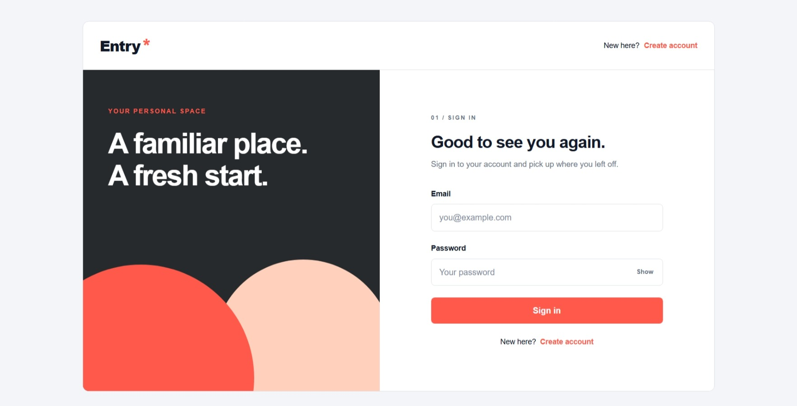
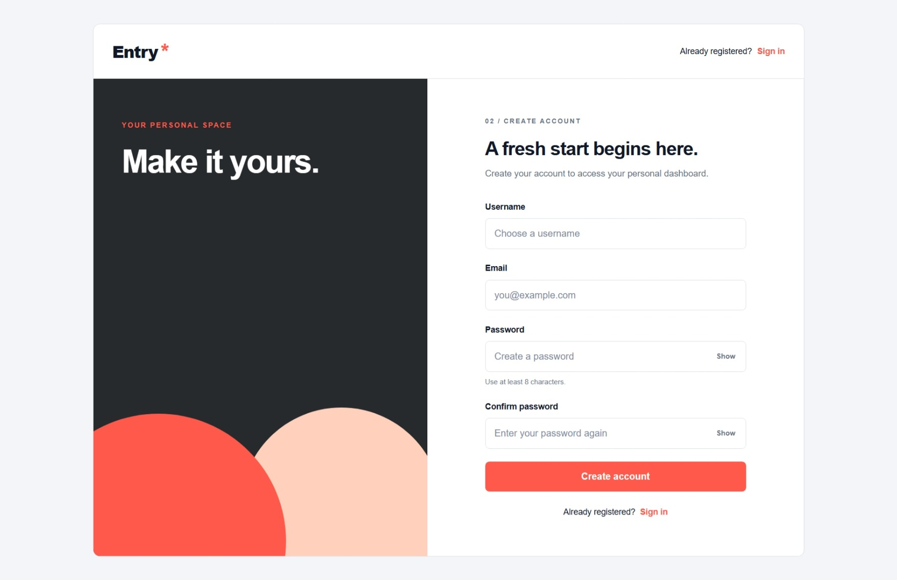
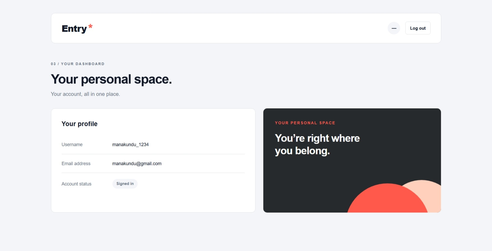
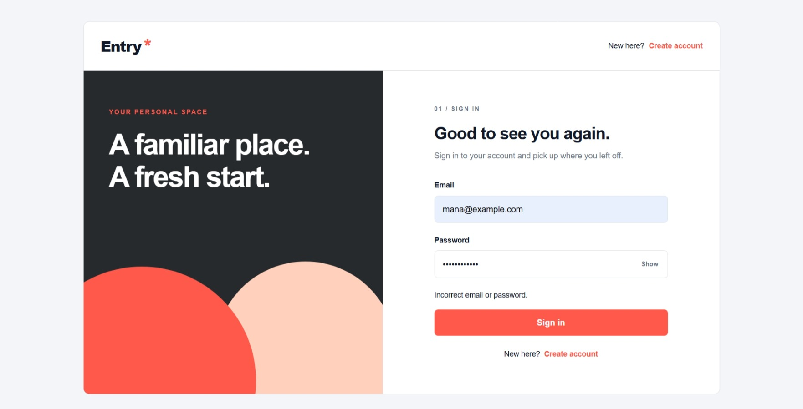

# Entry — Authentication System

Entry is a user authentication project built for the Week 2 Full Stack Development assignment. Users can create an account, sign in, view their profile on a protected dashboard, and log out.

## Live website

[Open Entry](https://entry-authentication-production.up.railway.app/)

Hosted on Railway with a Railway MySQL database.

## Demo video

[View or download the authentication demo](demo/entry-auth-demo.mp4)

The recording demonstrates registration, login, protected dashboard access, and logout using the local application.

## Screenshots

### Sign in


### Create account


### Protected dashboard


### Invalid credentials


## Tech stack

- Frontend: HTML, CSS, vanilla JavaScript
- Backend: Node.js and Express
- Database: MySQL
- Authentication: bcrypt, JSON Web Tokens, HttpOnly cookies, and database sessions
- Request limiting: express-rate-limit

## Features

- Registration with username, email, and password validation
- Unique usernames and email addresses
- Password hashing with bcrypt
- Password visibility controls
- JWT authentication with a one-hour expiry
- Protected dashboard and profile endpoint
- Profile details loaded from MySQL
- Logout deletes the session and clears the authentication cookie
- Registration and login rate limits
- Responsive layouts for desktop, tablet, and phone screens

Email verification and OTP authentication are not included.

## Project structure

| Path | Contents |
| --- | --- |
| `backend/controllers/` | Registration and login logic |
| `backend/middleware/` | JWT and session verification |
| `backend/routes/` | Authentication API routes |
| `backend/db.js` | MySQL connection pool |
| `backend/server.js` | Express server and frontend serving |
| `backend/.env.example` | Configuration template |
| `database/schema.sql` | Users and sessions table definitions |
| `frontend/` | Login, registration, dashboard, CSS, and JavaScript |
| `screenshots/` | Application screenshots |
| `demo/` | Authentication demo video |

## Local setup

1. Install Node.js and MySQL, then start the MySQL server.
2. Clone the repository:

```sh
git clone https://github.com/Shwetaleena-Kundu/entry-authentication.git
cd entry-authentication
```

3. Run `database/schema.sql` in MySQL to create the `entry` database and its tables.
4. Copy `backend/.env.example` to `backend/.env`. Enter your MySQL host, port, username, password, and database name. Keep `PORT=5001` and `NODE_ENV=development` for local use.
5. Generate a random secret and put its output in `JWT_SECRET`:

```sh
node -e "console.log(require('crypto').randomBytes(32).toString('hex'))"
```

6. Install dependencies and start the backend:

```sh
cd backend
npm ci
npm start
```

7. Open [http://localhost:5001/index.html](http://localhost:5001/index.html).

Express serves both the frontend and API. Use its address for authentication testing rather than opening the HTML files directly.

## Authentication endpoints

Registration and login accept JSON request bodies. Login sets a cookie; protected requests use that cookie.

| Method | Endpoint | Request / behaviour |
| --- | --- | --- |
| GET | `/api/health` | Returns the backend health message |
| POST | `/api/auth/register` | Accepts `username`, `email`, and `password`; creates an account |
| POST | `/api/auth/login` | Accepts `email` and `password`; creates a session and sets the JWT cookie |
| GET | `/api/auth/me` | Requires authentication; returns the user's profile |
| POST | `/api/auth/logout` | Requires authentication; deletes the session and clears the cookie |

Registration returns `201` on success, `400` for invalid input, and `409` for a duplicate username or email. Login returns `401` for incorrect credentials. Protected API access returns `401` without a valid session. Unexpected server errors return `500`.

The `/dashboard.html` route redirects unauthenticated visitors to the login page.

## Security notes

- Passwords are hashed with bcrypt using a cost factor of 12.
- Passwords must contain at least eight characters and cannot exceed bcrypt's 72-byte limit.
- Database queries use parameter placeholders.
- JWT signatures and expiry are checked before protected access.
- The session must also exist in MySQL and must not be expired.
- Authentication cookies use `HttpOnly` and `SameSite=Strict`; `Secure` is enabled in production.
- Logout invalidates the database session, so the previous token cannot authenticate again.
- Registration allows 10 attempts per IP per 15 minutes; login allows 20.
- Real credentials and secrets belong in `.env`, which is excluded from Git.

## Manual testing

The project author checked these flows locally:

- Successful registration and login
- Dashboard profile loading
- Logout and dashboard access after logout
- Incorrect password
- Duplicate account
- Mismatched registration passwords

Responsive CSS has been added. Session-expiry behaviour and mobile layout still need final verification.

## Deployment

The application is deployed on [Railway](https://entry-authentication-production.up.railway.app/) with MySQL. Express serves the frontend and API on the same origin.

- The root `package.json` installs backend dependencies and starts `backend/server.js`.
- Database credentials and `JWT_SECRET` are configured in Railway service variables.
- Production uses `NODE_ENV=production` and the host-provided `PORT`.
- The `users` and `sessions` tables are created in the Railway MySQL database.

The project author verified registration, login, dashboard profile loading, logout, and redirection to login when accessing the dashboard after logout on the live website.

Local accounts are separate from the deployed database; create an account on the live website to try it.
